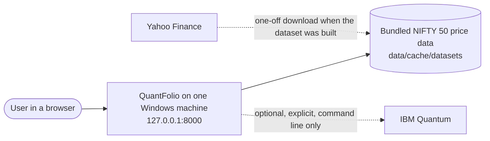
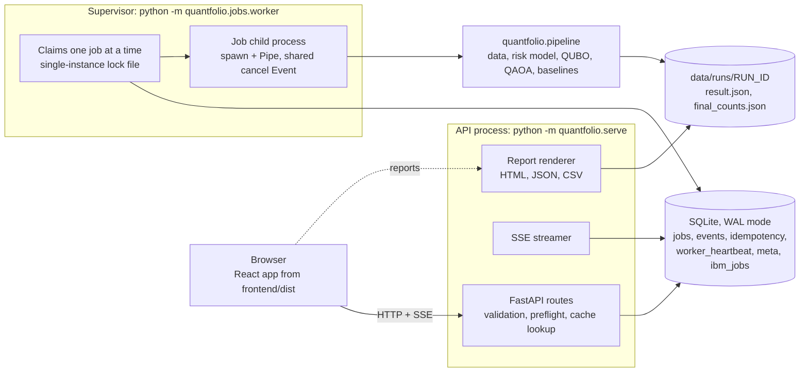
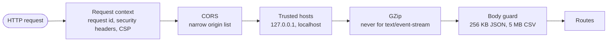
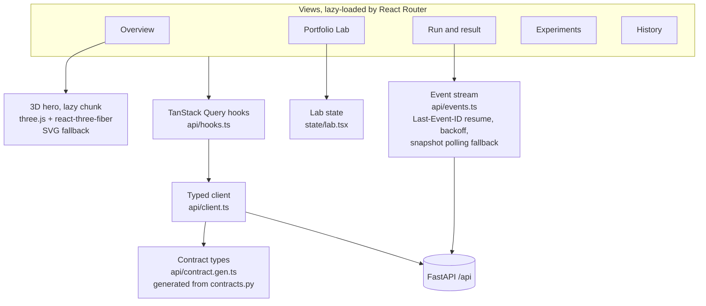
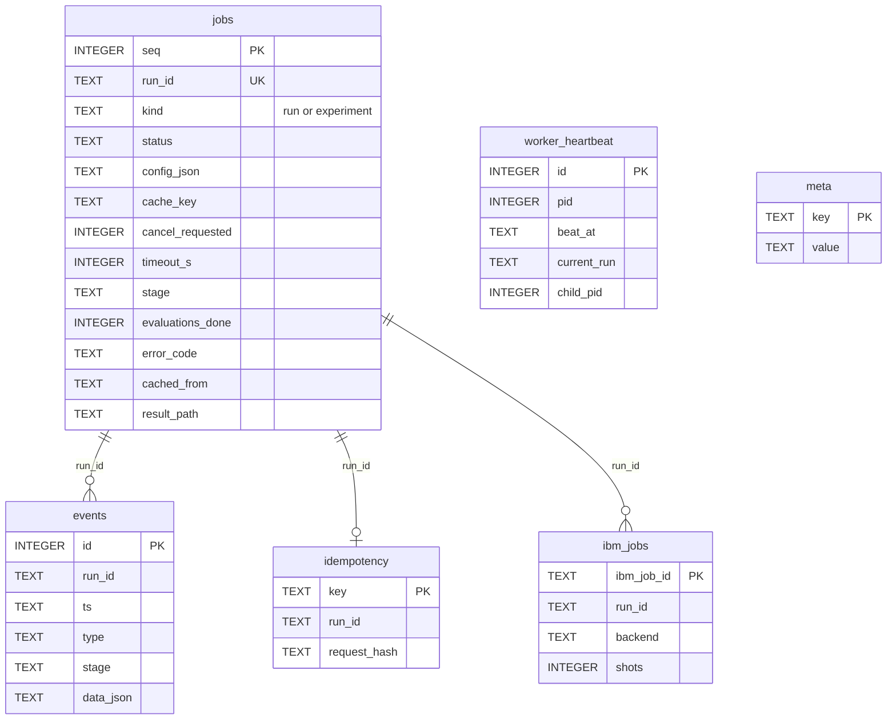
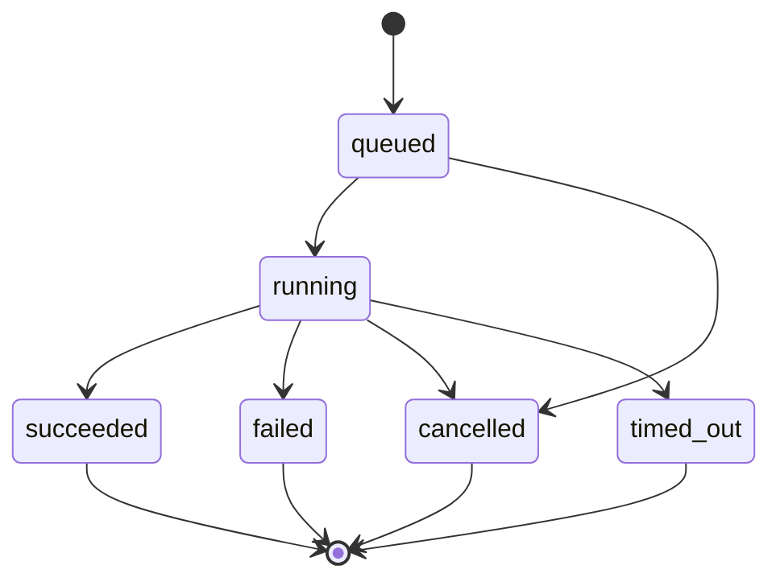
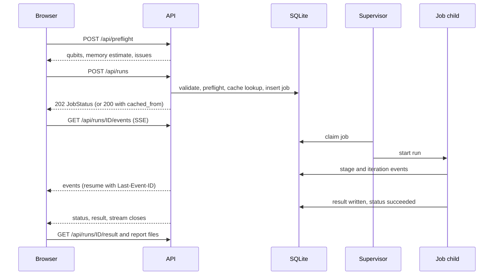
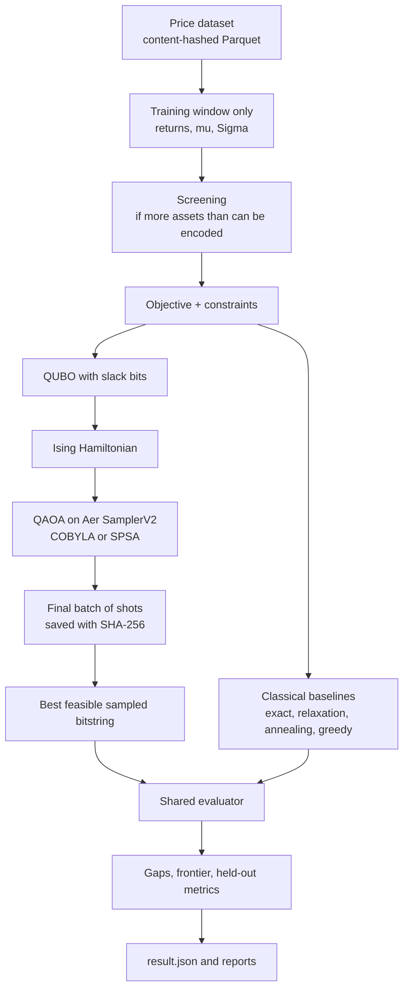

<div align="center">

# QuantFolio

**Portfolio selection as a constrained binary optimisation problem, solved with QAOA on a quantum simulator and checked against classical solvers on the same problem.**

SYRUS 7.0 · Problem statement PS-03 (Portfolio Optimisation using Quantum Computing) · Team Kryptonite

<!-- Project -->


<!-- Quantum and numerics -->


<!-- Platform -->


<!-- Frontend -->


<!-- Quality -->


</div>

---

## Contents

1. [What it does](#what-it-does)
2. [At a glance](#at-a-glance)
3. [Setup](#setup)
4. [Running it](#running-it)
5. [Troubleshooting](#troubleshooting)
6. [The web app](#the-web-app)
7. [Architecture](#architecture)
8. [How a run works](#how-a-run-works)
9. [The maths](#the-maths)
10. [Solvers](#solvers)
11. [Presets and limits](#presets-and-limits)
12. [Dataset](#dataset)
13. [API reference](#api-reference)
14. [Experiment results](#experiment-results)
15. [Performance and resilience](#performance-and-resilience)
16. [Testing and evidence](#testing-and-evidence)
17. [Security model](#security-model)
18. [Tech stack](#tech-stack)
19. [Project structure](#project-structure)
20. [Settings](#settings)
21. [Optional: IBM Quantum](#optional-ibm-quantum)
22. [Demo sequence](#demo-sequence-about-five-minutes)
23. [Known limitations](#known-limitations)
24. [Documentation index](#documentation-index)

---

## What it does

QuantFolio picks a portfolio of NIFTY 50 stocks under real constraints, and lets you compare a quantum algorithm with classical ones on exactly the same problem.

- **Formulates** the choice as a QUBO: risk, expected return and transaction costs in the objective; cardinality, sector caps, lot bounds and a target return as penalties.
- **Solves** it with QAOA (depths 1 to 5, COBYLA or SPSA, random or interpolated warm start) on the local Qiskit Aer simulator, with optional hardware-like noise.
- **Checks** the answer against exact enumeration, convex relaxation with rounding, simulated annealing and a greedy heuristic. One shared evaluator scores every solver.
- **Shows** live progress (stages and every optimiser evaluation), the efficient frontier, the bitstring histogram, sector allocation and held-out performance.
- **Exports** HTML, JSON and CSV reports rendered from the stored result, so the numbers in the report are the numbers on screen.
- **Runs offline** on one Windows machine at `127.0.0.1`. IBM Quantum is optional and never required.

It is a research and teaching tool. It does not claim a quantum advantage, and nothing in it is investment advice.

## At a glance

| | |
| --- | --- |
| Problem | Choose K of N NIFTY 50 stocks (or lot counts) minimising risk minus return plus costs, under constraints |
| Quantum method | QAOA, depth 1 to 5, on Qiskit Aer `SamplerV2` (statevector), optional FakeTorino-style noise |
| Classical checks | Exact enumeration, convex relaxation + rounding, simulated annealing, greedy |
| Largest problem | 24 qubits ideal, 14 qubits noisy, 20 assets for exact enumeration |
| Default example | 8 stocks, hold 4, 10 qubits; QAOA finds the same portfolio as exact enumeration |
| Typical run time | 5 to 16 s end to end for the default Quick run over HTTP; 0.35 s when replayed from cache |
| Interface | React web app with live progress over Server-Sent Events, plus a documented REST API |
| Tests | 154 core + 146 API tests passed; Vitest unit tests; Playwright end-to-end and axe-core accessibility tests |
| Load | 6,611 requests at up to 50 simulated users with 0 failures; 7 of 7 failure scenarios passed |

## Setup

### Prerequisites

| Requirement | Version | Notes |
| --- | --- | --- |
| Windows | 10 or 11 | Developed and tested on Windows 11 Home (PowerShell 5.1). |
| Python | 3.11 or newer | Built and tested with 3.13.2. Must be on PATH as `python`. |
| Node.js and npm | Node 20 or newer | Built and tested with Node 24.16.0 and npm 11.13.0. Needed only to build the web app. |
| Memory | about 2 GB free | A default run peaks at about 500 MB for the whole process tree; 24-qubit runs need more. |
| Disk | about 3 GB | Python packages, `node_modules`, Playwright browsers (only for end-to-end tests). |
| Internet | only during setup | Packages are downloaded once. The app itself never goes online; the price data is bundled. |

### One-command setup

```powershell
git clone https://github.com/CMPN-CODECELL/Syrus7_Kryptonite.git QuantFolio
cd QuantFolio
powershell -ExecutionPolicy Bypass -File scripts\setup.ps1
```

The project folder can live anywhere, including a path with spaces (it was developed in one).

`scripts\setup.ps1` does five things, and stops with a clear message if one fails:

1. Checks that Python 3.11+ is on PATH (exit code 2 if not).
2. Creates the virtual environment `backend\.venv` if it does not exist.
3. Installs the exact pinned package set from `backend\requirements.lock.txt` (direct dependencies are listed in `backend\requirements.in`).
4. Copies `.env.example` to `.env` if there is no `.env` yet. Every setting is optional.
5. Installs the frontend packages and builds the web app into `frontend\dist` (skip with `-SkipFrontend`).

All scripts keep their caches inside the project, so nothing fills up the system drive: pip in `.cache\pip`, npm in `.cache\npm`, Playwright browsers in `.cache\playwright`, and temporary files in `.tmp`.

### Manual setup (without the scripts)

```powershell
cd QuantFolio

# 1. Python environment
python -m venv backend\.venv
backend\.venv\Scripts\python.exe -m pip install -r backend\requirements.lock.txt

# 2. Settings (optional)
Copy-Item .env.example .env

# 3. Web app
cd frontend
npm ci
npm run build
cd ..

# 4. Start the server (serves the API and the built web app)
cd backend
.venv\Scripts\python.exe -m quantfolio.serve --port 8000
```

### Check the installation

```powershell
Invoke-RestMethod http://127.0.0.1:8000/api/health     # liveness
Invoke-RestMethod http://127.0.0.1:8000/api/ready      # checks.worker is true once the job worker is up
scripts\test.ps1 -Suite core -Fast                     # quick numerical self-test
```

## Running it

```powershell
scripts\start.ps1                       # foreground; Ctrl+C to stop
scripts\start.ps1 -Background -Open     # background, opens the browser when ready
scripts\stop.ps1                        # stops the background server
```

| Command | What it does |
| --- | --- |
| `scripts\setup.ps1 [-SkipFrontend]` | One-time setup, described above. |
| `scripts\start.ps1 [-Port 8000] [-Background] [-Open] [-Rebuild] [-NoBuild]` | Starts the API, the job worker and the built web app. Builds the web app first if `frontend\dist` is missing (`-Rebuild` forces a build, `-NoBuild` never builds). Refuses to start twice. Waits until the worker is ready. |
| `scripts\stop.ps1` | Stops a background server gracefully. Only ever stops the process recorded in `data\state\api.pid`. |
| `scripts\dev.ps1 [-ApiPort 8000] [-Fake]` | API plus the Vite dev server on `http://127.0.0.1:5173` with hot reload. `-Fake` uses the instant, deterministic test pipeline instead of the simulator. |
| `scripts\test.ps1 [-Suite all\|core\|api\|frontend] [-Fast]` | Runs the test suites in a single process and writes JUnit XML and text output to `evidence\`. `-Fast` skips tests marked slow or real. |
| `scripts\bench.ps1 [-Smoke] [-Real]` | Load and failure tests against a private local server. `-Smoke` is a 1-minute pass (output in `evidence\load\smoke\`); `-Real` runs only the timed real Quick jobs. |

| URL | What |
| --- | --- |
| `http://127.0.0.1:8000/` | Web app |
| `http://127.0.0.1:8000/api/docs` | Interactive API reference (OpenAPI at `/api/openapi.json`) |
| `http://127.0.0.1:8000/api/health` | Health check |
| `http://127.0.0.1:8000/api/example` | Saved genuine example run (needs no computation) |

Server logs from a background start are in `data\logs\serve.out.log` and `data\logs\serve.err.log`.

## Troubleshooting

| Symptom | Cause and fix |
| --- | --- |
| `start.ps1` exits with code 4: "Port 8000 is already in use" | Another program holds the port. Use `scripts\start.ps1 -Port 8010`. |
| "QuantFolio is already running at ..." | A background server is up. Use it, or run `scripts\stop.ps1` first. |
| Exit code 2: "The Python environment is missing" | Run `scripts\setup.ps1`. |
| "Python 3.x found; 3.11 or newer is required" | Install a newer Python from python.org and re-run setup. |
| "running scripts is disabled on this system" | Run the script through `powershell -ExecutionPolicy Bypass -File scripts\<name>.ps1`. |
| The page says "QuantFolio API is running ... the web interface has not been built yet" | `frontend\dist` is missing. Run `scripts\start.ps1 -Rebuild`, or `npm run build` in `frontend`. |
| "The server did not become ready" | Read `data\logs\serve.err.log`. Most often a broken package install; re-run setup. |
| A run is rejected before it starts | The preflight found a problem (too many qubits, conflicting constraints). The message names it and suggests a fix. |
| A run waits in the queue | One job runs at a time. Up to 8 can be queued; beyond that the API answers 429 with `Retry-After`. |
| Low memory on a small laptop | Keep to the Quick or Balanced preset and below 20 qubits; close other heavy programs. |

## The web app

| View | Route | Purpose |
| --- | --- | --- |
| **Overview** | `/` | What the project is, a 3D hero (with a static fallback when WebGL or motion is unavailable) and a link to a completed example run. |
| **Portfolio Lab** | `/lab` | Pick stocks, set the number to hold, sector caps, target return, costs and starting portfolio; choose a preset or open the advanced QAOA settings. A live preflight shows qubit count, memory estimate and any conflicting constraints before anything is queued. |
| **Run** | `/runs/:runId` | Live stages and convergence curve over Server-Sent Events, then the result: QAOA against each baseline, frontier, bitstring histogram, sector allocation, held-out metrics and report downloads. |
| **Experiments** | `/experiments` | Depth × optimiser × initial point × seed studies, with the effect of each factor and every cell in a table. |
| **History** | `/history` | Every stored run and experiment, with status filters and paging. |

Every view handles loading, empty, offline and error states, and works from 360 px phone width to wide desktop screens.

## Architecture

### System context



The running app has no network dependency. Yahoo Finance was used once to build the bundled dataset; IBM Quantum is used only when someone runs the IBM commands by hand.

### Processes

Three kinds of process on one machine. The API never computes; the supervisor never serves HTTP; each job gets its own child process, so a crash or a hang in one job cannot take the server down.



| Component | File | Role |
| --- | --- | --- |
| Entry point | `backend/quantfolio/serve.py` | Starts uvicorn, the supervisor and serves the built web app. |
| API | `api/app.py`, `api/routes.py`, `api/service.py`, `api/core.py` | Routes, request handling, job submission, result access. |
| Middleware and errors | `api/middleware.py`, `api/errors.py` | Host allow-list, security headers, body limits, one error envelope. |
| Job store | `jobs/store.py` | SQLite queue, events, idempotency keys, heartbeats. |
| Supervisor | `jobs/worker.py`, `api/worker_proc.py` | Single-instance lock, restart reconciliation, claim loop, cancellation, timeouts, heartbeat. |
| Job child | `jobs/child.py` | Runs exactly one pipeline call in a spawned process; one warm child is kept pre-spawned. |
| Test pipeline | `jobs/fake_pipeline.py` | Deterministic stand-in used by platform and load tests (`QF_PIPELINE_IMPL=fake`). |
| Pipeline | `pipeline.py` | `preflight`, `cache_key`, `run_optimisation`, `run_experiment`, `warmup`. |
| Reports | `reports/render.py` | HTML, JSON and CSV from the stored result file. |
| IBM (optional) | `ibm.py` | Account status and an explicit connectivity check. Submits nothing. |

### Request path through the middleware



### Frontend



The TypeScript contract types are generated from the Python pydantic models (`npm run gen:types`), and `npm run check:types` fails if the two drift apart.

### Storage

```
data/
├── state/
│   ├── quantfolio.sqlite3        job queue, events, idempotency keys, heartbeats (WAL mode)
│   ├── api.pid, worker.pid       process bookkeeping
│   └── worker.lock               single-instance lock of the supervisor
├── runs/<run_id>/                one folder per run: result.json, final_counts.json (+ .sha256)
├── examples/<run_id>/            the saved genuine example, imported read-only at start-up
├── cache/datasets/               immutable, content-hashed price datasets (Parquet + JSON metadata)
├── universe/                     NIFTY 50 constituent list and its source
├── uploads/                      CSV files uploaded in the web app
└── logs/                         server output of a background start
```

Run ids must match `^(run|exp)-\d{8}-[0-9a-f]{8}$`, and file paths are built only from validated ids.



### Job states



| Situation | Handling | Final state |
| --- | --- | --- |
| Cancel a queued job | The row moves straight to `cancelled`. | `cancelled` |
| Cancel a running job | A shared event is set; the pipeline checks it between evaluations. After a 3 s grace period the child is killed. | `cancelled` |
| Wall-clock timeout | The child is killed. | `timed_out` |
| Child dies (crash, out of memory) | The supervisor sees the dead process; the next job runs normally. | `failed` / `worker_crashed` |
| Server restarts mid-job | The running job is reconciled at start-up; queued jobs continue. | `failed` / `interrupted_by_restart` |

Full detail: [`docs/ARCHITECTURE.md`](docs/ARCHITECTURE.md).

## How a run works



- **Cache.** An identical configuration is replayed from the stored result and labelled with `cached_from` and `cached_original_time`. Add `?force_fresh=true` to compute again.
- **Idempotency.** The same `Idempotency-Key` with the same body returns the same job; with a different body it is rejected with 409 `idempotency_key_reused`.
- **Back-pressure.** At most 8 jobs are queued or running. The next submission gets 429 `queue_full` with `Retry-After`.

### Live events (SSE)

| Field | Meaning |
| --- | --- |
| `id` | Sequence number of the event; send it back as `Last-Event-ID` (or `?after=`) to resume without gaps. |
| `event` | `status`, `stage`, `iteration`, `log`, `result`, `error`, or `heartbeat`. |
| `data` | The full event as JSON: `{id, run_id, ts, type, stage, data}`. |

Iteration events are coalesced to at most 4 per second and carry every evaluation since the previous one in `points`. A heartbeat is sent every 10 s. The stream closes after the final status. If SSE is unavailable, the app polls `GET /api/runs/{id}/events/snapshot`.

### Inside the pipeline



Baselines run after the quantum result is final and cannot change it (tested).

## The maths

Each stock is a yes/no decision. The economic objective (minimised, annual units) is

```
f(w) = q * w' Sigma w  -  mu' w  +  cost(w)
```

with risk appetite `q`, covariance `Sigma` and expected returns `mu` estimated on the training window only, and one-off transaction costs measured from a disclosed starting portfolio.

| Piece | How it is handled |
| --- | --- |
| Decision variables | **Selection mode:** one bit per stock, exactly K chosen, weight 1/K each. **Lots mode:** bounded binary encoding of lot counts. |
| Cardinality | Equality penalty. |
| Sector caps | Inequality with bounded binary slack bits. |
| Target return | Inequality on quantised returns with slack bits. |
| Transaction costs | Proportional (basis points) plus a fixed fee per trade, from the starting portfolio. |
| QUBO | `E(z) = offset + lin·z + z'Uz = f_quad(x) + P · Σ pen_c(z)`. Slack bits count as qubits. |
| Ising mapping | `x = (1 - z) / 2`, so `h_i = -lin_i/2 - (rowsum_i U + colsum_i U)/4` and `J_ij = U_ij/4`. Sampled bitstrings are reversed to undo Qiskit's little-endian order. |
| QAOA circuit | `|psi(gamma, beta)> = prod_l U_M(beta_l) U_C(gamma_l) H^n |0>` with `RZ`, `RZZ` cost layers and `RX` mixer layers; the Hamiltonian is rescaled so angles are of order one. |
| Estimator | Sample mean or CVaR over the shots of each evaluation. |
| Optimisers | COBYLA (SciPy) or SPSA; the best parameters actually evaluated are returned, under an evaluation budget and a deadline. |
| Initial points | `random`, or `warm_interp` (INTERP: optimise depth p, interpolate to depth p+1). Warm-start evaluations are counted and reported. |
| Reported portfolio | The lowest-objective sample in the saved final batch that passes the exact constraint check. A baseline result is never substituted. |

If no sample in the final batch is feasible, the status is `no_feasible_sample` and no quantum portfolio is reported. Picking the best of many samples is post-selection, so the feasible probability and the probability of the selected string are always shown next to the portfolio. Every seed (initial point, transpiler, optimiser, each evaluation, final batch) derives from one user seed and is recorded in the result.

Full derivations and references: [`docs/MATH.md`](docs/MATH.md).

## Solvers

| Solver | Method | What it proves |
| --- | --- | --- |
| `qaoa` | Qiskit Aer `SamplerV2`, statevector method, depths 1 to 5, COBYLA or SPSA, `random` or `warm_interp` start | Nothing; heuristic |
| `exact` | Exhaustive enumeration of structurally valid portfolios (up to 1,200,000 candidates, 20 assets) | Optimality, or infeasibility |
| `relaxation_rounding` | Continuous relaxation (CVXPY + CLARABEL), rounding, local repair | A lower bound; infeasibility if the relaxation is infeasible |
| `simulated_annealing` | Structure-preserving moves, geometric cooling, seeded restarts | Nothing; heuristic |
| `greedy` | Constructive, no local search | Nothing; heuristic |

The gap of each solver is measured against the exact optimum when it ran, otherwise against the best known value, and the reference used is always stated. The frontier shows three kinds of points that are never mixed: the continuous relaxation curve (an optimistic reference), the discrete feasible portfolios, and each solver's portfolio.

## Presets and limits

| Preset | Depth | Initial point | Shots / final shots | Evaluations | Max assets | Timeout | Measured on the default example (warm worker) |
| --- | --- | --- | --- | --- | --- | --- | --- |
| Quick | 1 | random | 256 / 1024 | 25 | 10 | 90 s | median 2.49 s, p95 2.86 s |
| Balanced | 2 | warm_interp | 512 / 2048 | 60 | 14 | 300 s | median 9.07 s, p95 9.7 s |
| Research | 3 | warm_interp | 1024 / 4096 | 150 | 16 | 1200 s | median 26.75 s, p95 28.28 s |

All presets use COBYLA. These are pipeline times inside an already warm worker; end-to-end times over HTTP are in [Performance](#performance-and-resilience).

| Limit | Value |
| --- | --- |
| Total qubits (decision + slack), ideal simulation | 24 |
| Total qubits with a fake-backend noise model | 14 |
| Assets for exact enumeration | 20 |
| Memory limit per job | 1500 MB |
| QAOA depths | 1 to 5 |
| Jobs queued or running at once | 8 (then 429 with `Retry-After`) |
| Compute workers | 1 |
| Upload size | 5 MB CSV |
| JSON request body | 256 KB |

Requests beyond these limits are rejected by the preflight before they are queued. The limits come from a benchmark on the development laptop (`evidence/experiments/qubit_benchmark.json`):

| Qubits | Ideal, s per evaluation (depth 1, 256 shots) | Peak memory, fresh process |
| --- | --- | --- |
| 8 | 0.014 | – |
| 12 | 0.028 | – |
| 16 | 0.057 | 274 MB |
| 20 | 1.56 | 281 MB |
| 22 | 3.09 | 329 MB |
| 24 | 7.05 | 521 MB |

With the FakeTorino noise model one evaluation took 0.31 s at 6 qubits, 6.09 s at 12 and 30.2 s at 14.

**Default example.** 8 stocks (HDFCBANK, ICICIBANK, SBIN, INFY, TCS, ITC, HINDUNILVR, BHARTIARTL), hold 4, at most 1 from Financial Services and 2 from any other sector, a 15% target return, and costs of 25 bps plus INR 20 per trade from an existing four-stock portfolio (HDFCBANK 30%, TCS 30%, HINDUNILVR 20%, INFY 20%). This needs 10 qubits (8 decision + 2 slack). In the saved run `run-20261008-f29dc129`, QAOA, exact enumeration, relaxation with rounding and simulated annealing all report the same portfolio (bitstring `00101101`), with objective −0.18992.

## Dataset

| Item | Value |
| --- | --- |
| Dataset id | `nifty50-yahoo-aaa53c0c94ef` |
| Universe | The 50 NIFTY 50 constituents, NSE list as of 2026-10-08 (`data/universe/SOURCE.md`) |
| Source | Yahoo Finance via yfinance 1.7.0, daily adjusted closes |
| Range | 2019-01-01 to 2026-10-08, 1925 rows, 50 symbols |
| Downloaded | 2026-10-08 |
| SHA-256 | `aaa53c0c94ef942dfb631ae14ca2c91e2bf0e72ca3b1b40d579efec14ded4a78` |
| Default split | Train 2022-01-03 to 2024-12-31 · validation 2025-01-01 to 2025-09-30 · test 2025-10-01 to 2026-10-07 |
| Missing data | Forward-filled for at most 5 trading days, inside the training window only |

- The app never downloads anything on its own. It runs from this cache, stored as immutable content-hashed Parquet with JSON metadata.
- Every dataset carries one of four labels: `downloaded historical`, `stale cache`, `uploaded`, `synthetic test`. The label and the hash are printed in every report.
- You can upload your own price CSV in the web app (labelled `uploaded`).
- **Known weaknesses, recorded in the metadata:** today's index membership is applied to earlier years (survivorship bias); three weekend rows; a gap for INDIGO; late starts for MAXHEALTH (2020-08-21), ETERNAL (2021-07-23) and JIOFIN (2023-08-21).
- Estimates, screening, the QUBO and the trained parameters use the training window only. Changing every price after the training end changes only the held-out metrics (tested).

Full description: [`docs/DATA.md`](docs/DATA.md).

## API reference

All paths are under `/api`. Errors use one envelope: `{"error": {"code", "message", "details?", "request_id?"}}`.

| Method | Path | Purpose |
| --- | --- | --- |
| GET | `/health` | Liveness. |
| GET | `/ready` | Readiness, including whether the worker is up. |
| GET | `/assets` | Stocks in the active dataset, with sectors. |
| GET | `/data/status` | Active dataset and the datasets available. |
| POST | `/data/upload` | Upload a price CSV (5 MB limit; parsed, never executed). |
| GET | `/presets` | The three presets and the default configuration. |
| GET | `/capabilities` | Limits, depths, optimisers, noise models, queue capacity. |
| POST | `/preflight` | Qubit count, memory estimate and conflicts for a configuration. Queues nothing. |
| POST | `/runs` | Submit a run. 202, or 200 when replayed from cache. |
| POST | `/experiments` | Submit an experiment matrix. 202. |
| GET | `/runs` | List runs: `status`, `kind`, `limit` (1 to 200), `offset`. Total in `X-Total-Count`. |
| GET | `/runs/{id}` | Job status. |
| POST | `/runs/{id}/cancel` | Request cancellation. |
| GET | `/runs/{id}/config` | The submitted configuration, for every status. |
| GET | `/runs/{id}/result` | The stored result. |
| GET | `/runs/{id}/events` | Server-Sent Events; resume with `Last-Event-ID` or `?after=`. |
| GET | `/runs/{id}/events/snapshot` | The same events as JSON, for polling. |
| GET | `/runs/{id}/report.html` · `report.json` · `report.csv` | Reports rendered from the stored result. |
| GET | `/runs/{id}/counts.csv` | Raw counts of the final sampling batch. |
| GET | `/example` | The saved genuine example run. |
| GET | `/ibm/status` | Whether an IBM token is configured. Local only, no network. |
| POST | `/ibm/check` | Explicit connectivity check. Lists backends, submits nothing. |

| Error code | HTTP | When |
| --- | --- | --- |
| `queue_full` | 429 | 8 jobs already queued or running; see `Retry-After`. |
| `idempotency_key_reused` | 409 | Same `Idempotency-Key`, different body. |
| `result_not_available` | 409 | Result or report requested before the run succeeded. |
| `result_missing` | 410 | The stored result file is gone; submit again. |
| `worker_crashed` | – | Job status when the child process died. |
| `interrupted_by_restart` | – | Job status when the server restarted mid-job. |
| `internal_error` | 500 | Unexpected error; the message is safe and carries a request id. |

Try it from PowerShell:

```powershell
$cfg = (Invoke-RestMethod http://127.0.0.1:8000/api/presets).default_config
$job = Invoke-RestMethod http://127.0.0.1:8000/api/runs -Method Post -ContentType 'application/json' -Body ($cfg | ConvertTo-Json -Depth 20)
Invoke-RestMethod "http://127.0.0.1:8000/api/runs/$($job.run_id)"
```

The full contract: [`docs/CONTRACT.md`](docs/CONTRACT.md), or `/api/docs` on a running server.

## Experiment results

From `backend/scripts/experiments.py --matrix`: 72 QAOA runs and 5 paired ideal-versus-noisy trials on the development laptop (`evidence/experiments/RESULTS.md`, `cells.csv`).

**Full factorial, 6 stocks, 8 qubits:** depth 1 to 5 × COBYLA/SPSA × random/warm start × 3 seeds = 60 cells, 30 evaluations of 256 shots each, final batch 1024 shots, 189 s in total.

| Finding | Number |
| --- | --- |
| Approximation ratio | 1.000 in every one of the 60 cells: the optimum was among the final samples every time. |
| Feasible probability, random start | 0.138 ± 0.065 |
| Feasible probability, warm start | 0.194 ± 0.082, at the price of 41.8 evaluations instead of 29.9 |
| COBYLA against SPSA | 0.168 against 0.163 feasible probability; no meaningful difference |
| Depth | No clear gain from depth 1 to 5 at this size |

Read this honestly: at 8 qubits there are only 256 basis states, so finding the optimum among 1024 shots is weak evidence about the circuit. The feasible probability is the more informative number, and it stays between 0.1 and 0.25. In the universe-size study the approximation ratio falls below 1 at the two largest sizes (0.963 and 0.905). The noise study and all per-cell values are in `RESULTS.md`.

The configuration-selection rule uses training data only (highest mean approximation ratio, then feasible probability, then fewer evaluations, then lower depth); validation figures are reported, and test data is never used for selection.

## Performance and resilience

Measured on the development laptop (Intel i5-1135G7, 4 cores / 8 threads, 16 GB RAM, a few GB free), one run per stage. Full write-up: [`docs/PERFORMANCE.md`](docs/PERFORMANCE.md).

**Load (test pipeline, Locust on the same machine): 6,611 requests, 0 failures.**

| Stage | Users | Duration | Requests | p50 | p95 | p99 | Requests/s |
| --- | --- | --- | --- | --- | --- | --- | --- |
| ramp-01 | 1 | 40 s | 44 | 5 ms | 10 ms | 31 ms | 1.14 |
| ramp-10 | 10 | 40 s | 559 | 5 ms | 15 ms | 46 ms | 14.68 |
| ramp-25 | 25 | 40 s | 1,231 | 6 ms | 26 ms | 110 ms | 24.30 |
| ramp-50 | 50 | 40 s | 2,250 | 8 ms | 100 ms | 700 ms | 44.87 |
| soak-10 | 10 | 180 s | 2,527 | 6 ms | 14 ms | 59 ms | 14.18 |

Server memory stayed at or below 134 MB with no growth over the soak. At 50 users, 16 submissions were answered 429.

**Real Quick jobs over HTTP (local Aer simulator, default example):**

| Measurement | Back to back | After 15 s idle |
| --- | --- | --- |
| Server start to ready | 7.5 s | 6.2 s |
| First job straight after start | 10.2 s | 15.8 s |
| Median / max of four fresh jobs | 11.7 / 13.6 s | 6.5 / 15.8 s |
| Cache replay | 0.34 s | 0.35 s |
| Peak memory (process tree) | 497 MB | 498 MB |

All 8 fresh jobs succeeded and QAOA matched the exact optimum in each.

**Failure scenarios (all seven passed):**

| Scenario | Outcome |
| --- | --- |
| Queue saturation | 30 submissions in 0.16 s: 8 accepted, 22 answered 429 with `Retry-After: 10`; all 8 succeeded. |
| SSE fan-out, 40 clients | Every client received the same 41 ordered events. |
| Cancel storm | 8 jobs, 3 cancel calls each: all returned 200, all jobs cancelled within 0.38 s. |
| 120 dropped SSE connections | The job still succeeded; server threads returned from 32 to 4. |
| Missing cached result | 410, then an identical submission ran fresh and succeeded. |
| Worker killed mid-job | Ready again in 0.43 s; the running job became `interrupted_by_restart`; the queued job succeeded; no orphan process. |
| Mocked IBM outage | 502, then 504; no token in any response; health stayed available. |

SSE event lag was 0.30 to 0.32 s at p95 with 1 to 40 clients. A cancel call returned in 4.3 ms and the job was cancelled 0.93 s later.

**Web app (Playwright, mobile profile: slow 4G and 4x CPU slowdown):** largest contentful paint 2.36 s on `/` and 2.31 s on `/lab` (budget 2.5 s), cumulative layout shift 0.002, interaction to next paint 19 ms typical and 35 ms with the slowed CPU.

**Known bottlenecks:** one compute worker, so jobs queue behind each other; `GET /api/presets` reached 800 ms at p95 under a 50-user start-up burst.

## Testing and evidence

| Suite | Command | Last recorded result | Evidence |
| --- | --- | --- | --- |
| Core (maths, QUBO, QAOA, baselines, pipeline) | `scripts\test.ps1 -Suite core` | 154 passed, 0 failed, 0 skipped, 66 s | `evidence/core-tests/` |
| API (jobs, SSE, restart, uploads, reports, IBM mock) | `scripts\test.ps1 -Suite api` | 146 passed, 0 failed, 0 skipped, 421 s | `evidence/api-tests/` |
| Frontend unit (Vitest) | `cd frontend; npm test` | 45 passed, 0 failed | `evidence/e2e/vitest-junit.xml` |
| Lint and types | `cd frontend; npm run lint; npm run typecheck` | 0 errors, 0 warnings | – |
| End to end, real backend (Playwright, Chromium) | `cd frontend; npm run e2e` | 14 passed; 0 console errors, 0 failed requests | `evidence/e2e/`, `evidence/screenshots/` |
| UI states, scripted backend (Playwright, Chromium) | `cd frontend; npm run e2e` | 16 passed (loading, empty, offline, error, cancelled, failed, timed out) | `evidence/screenshots/states/` |
| Main journey on Firefox and WebKit | `cd frontend; npx playwright test --project=firefox` (or `webkit`) | 1 + 1 passed | `evidence/e2e/playwright-firefox.log` |
| Accessibility (axe-core) | part of `npm run e2e` | 16 scans, 0 violations | `evidence/a11y/` |
| Load and failure | `scripts\bench.ps1` | 6,611 requests, 0 failed; 7 of 7 scenarios passed | `evidence/load/` |
| Experiments | `backend\scripts\experiments.py --matrix` | 72 QAOA runs + 5 noise trials | `evidence/experiments/` |

```powershell
scripts\test.ps1                 # core + API + frontend unit suites
scripts\test.ps1 -Suite core     # numerical tests only, about 1 to 2 minutes
scripts\test.ps1 -Suite api      # platform tests only, about 7 minutes
scripts\bench.ps1 -Smoke         # 1-minute load and failure pass
scripts\bench.ps1                # full bounded pass, about 10 minutes
scripts\bench.ps1 -Real          # only the timed real Quick jobs, about 1 minute
cd backend; .venv\Scripts\python.exe scripts\experiments.py --dry-run     # plan of the experiment matrix
cd backend; .venv\Scripts\python.exe scripts\experiments.py --matrix      # run it
```

What the suites cover, in short:

- **Core:** every constraint encoding against brute force, QUBO and Ising energies equal for every basis state of small instances, bit order, the shared evaluator, each baseline, QAOA seeding and determinism, cancellation and deadlines, data hashing and leakage (changing test-period prices changes nothing upstream).
- **API:** request validation and error envelopes, the job lifecycle, cancel races, timeouts, crash isolation, restart reconciliation, idempotency, cache replay, SSE ordering and resume, uploads, reports, and the IBM endpoints against a mock.
- **End to end:** the main journey in a real browser against the real backend, every view at several widths, loading/empty/offline/error states, accessibility checks with axe-core, and page performance.

Before handoff the app was also walked through by hand in Chrome against the real server: Overview, Lab, a cached replay and a fresh Quick run (7.2 s, live events), History, the not-found page and an unknown run id, the mobile menu, and all four downloads. There were no console messages and no failed requests; JSON responses were gzip-compressed and the event stream was not; the HTML, JSON and CSV numbers matched the screen.

No test or load test contacts IBM, Yahoo or any other third party. How each requirement of the problem statement maps to code, tests and evidence: [`docs/COVERAGE.md`](docs/COVERAGE.md).

## Security model

- The server binds to `127.0.0.1` and has no login. Do not expose it to a network.
- Host allow-list, narrow CORS, security headers and a content security policy on every response.
- Request limits: 256 KB JSON, 5 MB CSV. `NaN` and `Infinity` are rejected.
- The API never accepts file paths, URLs or expressions from a client. Uploads are CSV only and are parsed, never executed.
- Run ids must match `^(run|exp)-\d{8}-[0-9a-f]{8}$` before any file is touched.
- `IBM_QUANTUM_TOKEN` is optional, read only from the environment, never logged, never written to reports and never passed to the job worker.
- `.env`, the SQLite state, run results, logs and uploads are excluded from git.

## Tech stack

| Layer | Technology |
| --- | --- |
| Quantum | Qiskit 2.5.2, Qiskit Aer 0.17.2 (`SamplerV2`), qiskit-algorithms 0.4.0, qiskit-ibm-runtime 0.50.0 (optional) |
| Optimisation and numerics | CVXPY 1.9.3 with CLARABEL 0.11.1 and HiGHS 1.15.1, SciPy 1.18.1, NumPy 2.5.3, pandas 3.0.6, scikit-learn 1.9.1 |
| Data | yfinance 1.7.0 (one-off download), PyArrow 25.0.1 (Parquet) |
| API | FastAPI 0.143.0, uvicorn 0.54.0, sse-starlette 3.5.0, pydantic 2.14.0, psutil 7.2.2 |
| Storage | SQLite in WAL mode, JSON result files |
| Frontend | React 19, TypeScript 6.0, Vite 8, Tailwind CSS 4, React Router 8, TanStack Query 5 |
| Charts and 3D | Recharts 3, three.js with @react-three/fiber 9 |
| Fonts | Fraunces, Inter, JetBrains Mono (bundled through Fontsource, no network) |
| Testing | pytest 9.1.1, Hypothesis, httpx, Vitest 5, Testing Library, Playwright, axe-core, Locust 2.46 |
| Tooling | ESLint 10 with zero warnings allowed, TypeScript type check, pip-audit, ruff |

## Project structure

```
QuantFolio/
├── backend/
│   ├── quantfolio/
│   │   ├── pipeline.py          entry point: preflight, run_optimisation, run_experiment
│   │   ├── contracts.py         pydantic models shared with the frontend
│   │   ├── presets.py           presets and resource limits
│   │   ├── portfolio.py         the shared evaluator
│   │   ├── qubo.py              QUBO assembly and Ising mapping
│   │   ├── risk.py              return and covariance estimation
│   │   ├── screening.py         subset choice when too many assets are requested
│   │   ├── frontier.py, explain.py, assemble.py
│   │   ├── constraints/         cardinality, sector, lots, target_return, costs
│   │   ├── quantum/             circuit, qaoa, optimizers, sampling, warm_start, noise
│   │   ├── classical/           exact, relaxation, annealing, greedy
│   │   ├── data/                store, universe, upload, synthetic, paths
│   │   ├── api/                 app, routes, service, core, middleware, errors, worker_proc
│   │   ├── jobs/                store, worker, child, examples, fake_pipeline
│   │   ├── reports/             render (HTML, JSON, CSV)
│   │   └── serve.py, settings.py, ibm.py, logging_utils.py
│   ├── tests/core/              numerical tests
│   ├── tests/api/               platform tests
│   ├── loadtest/                Locust users, failure scenarios, event lag, real job timings
│   ├── scripts/experiments.py   experiment matrix, qubit benchmark, preset calibration
│   ├── requirements.in          direct dependencies
│   └── requirements.lock.txt    full pinned set
├── frontend/
│   ├── src/api/                 typed client, SSE stream, query hooks, generated contract types
│   ├── src/views/               Overview, lab/, run/, Experiments, History, NotFound
│   ├── src/components/          charts/, hero/, layout/, ui/
│   ├── src/lib/                 formatting, validation, result helpers, storage
│   ├── src/state/               Portfolio Lab state
│   └── e2e/                     Playwright journeys, states, views, performance
├── data/
│   ├── universe/                NIFTY 50 list and its source
│   ├── cache/datasets/          the bundled price dataset
│   └── examples/                one genuine saved run
├── docs/                        MATH, DATA, ARCHITECTURE, CONTRACT, COVERAGE, PERFORMANCE, STATUS
├── evidence/                    test reports, load output, experiments, screenshots, accessibility
├── scripts/                     setup, start, stop, dev, test, bench (PowerShell)
├── .env.example                 every setting, all optional
└── README.md
```

## Settings

Copy `.env.example` to `.env` (setup does this). Every value is optional.

| Variable | Default | Meaning |
| --- | --- | --- |
| `QF_API_HOST` | `127.0.0.1` | Bind address. Keep it local. |
| `QF_API_PORT` | `8000` | Port. |
| `QF_CORS_ORIGINS` | – | Extra allowed origins, for the Vite dev server. |
| `QF_DATA_DIR` | `data\` | Root for datasets, state, runs and logs. |
| `QF_STATE_DIR`, `QF_RUNS_DIR` | under `QF_DATA_DIR` | Where the SQLite file and run results live. |
| `QF_QUEUE_CAPACITY` | `8` | Jobs queued or running at once. |
| `QF_EXPERIMENT_TIMEOUT_S` | `3600` | Timeout for an experiment job, in seconds. |
| `QF_PIPELINE_IMPL` | `real` | `real`, or `fake` for the instant test pipeline. |
| `QF_LOG_LEVEL` | `INFO` | Log level. |
| `QF_FRONTEND_DIST` | `frontend\dist` | Where the built web app is served from. |
| `QF_MAX_UPLOAD_BYTES` | 5 MB | Upload limit. |
| `QF_SSE_HEARTBEAT_S` | `10` | Seconds between SSE heartbeats. |
| `QF_CANCEL_GRACE_S` | `3` | Grace period before a cancelled child is killed. |
| `QF_WARM_WORKER` | `true` | Keep one pre-spawned job child warm. |
| `QF_START_WORKER` | `true` | Start the job worker together with the API. |
| `QF_ITERATION_FLUSH_HZ` | `4` | Maximum iteration events per second on the live stream. |
| `QF_MAX_EVENTS_PER_RUN` | `3000` | Cap on stored events per run. |
| `IBM_QUANTUM_TOKEN`, `IBM_QUANTUM_INSTANCE` | empty | Optional IBM Quantum account. |

## Optional: IBM Quantum

Not needed for anything above. To check an account, put `IBM_QUANTUM_TOKEN` (and optionally `IBM_QUANTUM_INSTANCE`) in `.env`, then:

```powershell
cd backend
.venv\Scripts\python.exe -m quantfolio.ibm status    # local only, no network
.venv\Scripts\python.exe -m quantfolio.ibm check     # lists visible backends, submits nothing
```

The web app shows the same status and offers the same explicit check. Nothing in the app, the tests or the load tests submits hardware jobs.

## Demo sequence (about five minutes)

1. `scripts\start.ps1 -Background -Open`. On the overview, open the completed example: a genuine recorded run, labelled as such.
2. Portfolio Lab: keep the default 8 stocks, hold 4, and start the run. Stages and the convergence curve arrive live (5 to 16 s).
3. Results: QAOA against exact enumeration, relaxation with rounding and simulated annealing on the same problem; frontier, bitstring histogram, sector allocation.
4. Conflict: set a target return no 4-stock portfolio can reach. The preflight names the conflicting constraints and nothing is queued.
5. Noise: in the advanced settings, choose a fake-backend noise model, tick the noise comparison and run again. The result shows ideal against noisy sampling at the same parameters.
6. Export the HTML or JSON report; the numbers are the stored ones.

Fallback if anything goes wrong live: `http://127.0.0.1:8000/api/example` and the saved run in `data/examples/` need no computation.

## Known limitations

- **Simulator only.** No real-hardware run was made, and re-sampling a stored run on IBM hardware from the command line is not wired up.
- **One compute worker.** Jobs run one after another, so waiting time grows when several people submit at once.
- **No login and no per-user data.** Localhost only.
- **Survivorship bias.** Historical results use today's index membership and say nothing about future returns.
- **Small problems only (24 qubits).** Nothing here shows a quantum advantage; at these sizes exact enumeration is faster.
- **Not supported, rejected by the preflight:** count-basis sector caps in lots mode, and warm start together with noisy optimisation at depth above 1.
- **Measurements** come from one laptop and one run per stage.
- **Small UI rough edges** (wide tables scroll inside their card on phones, some chart labels wrap) are listed in [`docs/UI.md`](docs/UI.md).

## Documentation index

| Document | Contents |
| --- | --- |
| [`docs/MATH.md`](docs/MATH.md) | Formulation, QUBO, Ising mapping, QAOA, optimisers, baselines, resource limits, references |
| [`docs/DATA.md`](docs/DATA.md) | Universe, dataset provenance, quality findings, estimation, missing-data policy |
| [`docs/ARCHITECTURE.md`](docs/ARCHITECTURE.md) | Processes, job lifecycle, cancellation and crash handling, storage, security |
| [`docs/CONTRACT.md`](docs/CONTRACT.md) | API endpoints, error codes, ownership |
| [`docs/COVERAGE.md`](docs/COVERAGE.md) | Problem-statement requirements mapped to code, tests and evidence |
| [`docs/PERFORMANCE.md`](docs/PERFORMANCE.md) | Load stages, failure scenarios, real job timings, bottlenecks |
| [`docs/MAC_TEST_PROMPT.md`](docs/MAC_TEST_PROMPT.md) | Validation plan for a macOS machine |
| [`evidence/experiments/RESULTS.md`](evidence/experiments/RESULTS.md) | Experiment matrix results |

---

<div align="center">

**Team Kryptonite** · Team leader: Avinash Gehi · SYRUS 7.0, PS-03

Past performance in the bundled dataset says nothing about future returns. This is a research and teaching tool, not investment advice.

</div>
